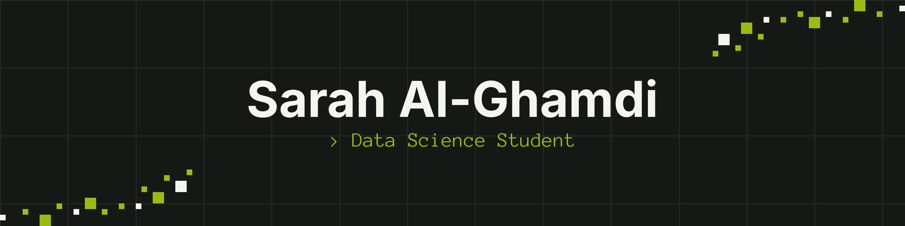

Data Science student. I like turning data into decisions, and I learn by building and documenting what I learn.

### Projects
- **[ShedLens](https://github.com/m000n-o00o/ShedLens)**: classifying bloodstain pattern mechanisms (gunshot vs. impact) with transfer learning. *In progress.*
- **[Martian Map](https://github.com/m000n-o00o/martian-map)**: an interactive map that plans a Marswalk route in Jezero Crater, built at NASA Space Apps Challenge 2026. [Live demo](https://m000n-o00o.github.io/martian-map/)
- **[Data Science from Scratch](https://github.com/m000n-o00o/data-science-from-scratch)**: implementing core data science concepts from scratch in Python while studying Joel Grus's book.
- **[Falcons at EWC 2026](https://github.com/m000n-o00o/falcons-ewc2026-analysis)**: what separates winners from losers in Rocket League, and where Team Falcons stands at the Esports World Cup 2026.

### Tools

  
  
  
  
  
  
  

### Contact
sarah.alghamdi.ds@gmail.com
